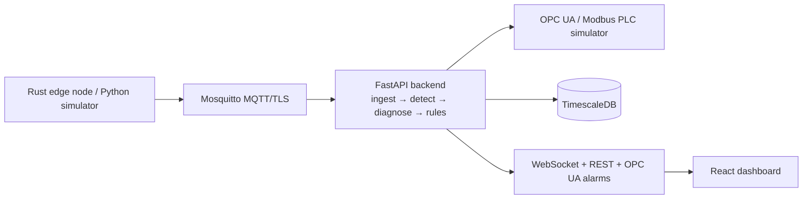

# PipeGuard

**Vibration monitoring, diagnosis and bounded response for petroleum pipelines.**

PipeGuard is a production-style prototype: signed sensor telemetry → layered
detection → evidence-based diagnosis → safety-gated actuation → alarms and
incident reports. All hardware is simulated, so the whole loop is testable
end to end.

> Safety posture: **ADVISORY by default**. PipeGuard never writes to SIS/ESD,
> never auto-closes mainline valves, and blocks automation on sensor faults,
> stale data, kill switch, or any limit violation. See
> [docs/safety-and-compliance.md](docs/safety-and-compliance.md).

## Architecture at a glance



Full design: [docs/architecture.md](docs/architecture.md).

## Quickstart

Prerequisites: Docker with Compose, Python 3.12+, Node 20+, Rust (optional;
firmware also builds in Docker).

```bash
# 1. Install local Python/JS dependencies
make install

# 2. Start the full stack (broker, TimescaleDB, backend, dashboard, simulator, PLC)
make up

# 3. Run the deterministic end-to-end scenario (no manual steps)
make demo
```

- Dashboard: <http://localhost:5173> (demo users: `viewer`, `operator`,
  `engineer`, `admin` — password equals username)
- Backend API / OpenAPI docs: <http://localhost:8000/docs>
- MQTT: `localhost:1883` (node creds `node-03` / `device-secret`)

`make demo` runs: normal → cavitation injected → detection → advisory
recommendations → explicit AUTO enable → bounded VFD speed reduction → effect
verification → incident report in `docs/reports/incidents/`.

## Make targets

| Target | Purpose |
|---|---|
| `make up` / `make down` | Start/stop the Docker Compose stack |
| `make test` | Run all Python unit tests |
| `make lint` | ruff, mypy, eslint, TypeScript build, Rust image build |
| `make sim` | Generate a 60 s fault scenario to `features.jsonl` |
| `make demo` | Run the end-to-end in-process demo scenario |
| `make eval` | Generate the diagnosis confusion-matrix report |
| `make firmware-test` | Run Rust unit tests in Docker |

## Repository map

```
firmware/   Rust edge node: SensorTrait, DSP, HMAC, ring buffer, MQTT
simulator/  Python signal/fault simulator and message generator
backend/    FastAPI ingestion, detection, diagnosis, rules, actuation, alarms
dashboard/  React control-room UI
plc-sim/    OPC UA + Modbus simulated VFD/pump/valve
infra/      Docker Compose, Mosquitto, TimescaleDB migrations
docs/       Architecture, safety case, runbook, API spec, reports
scripts/    End-to-end demo
```

## Tests and quality

- Python unit tests cover DSP, all fault signatures, message signatures,
  ingestion dedupe/lateness, detection debounce, diagnosis, **safety gates
  (kill switch, SIS/ESD deny-list, bounds, step, rate, cooldown, envelope,
  rollback, fail-safe)**, alarms and reports.
- Rust unit tests cover the DSP and simulator core; run with `make firmware-test`.
- `make lint` runs ruff + mypy + eslint + `tsc` + Rust container build.
- Diagnosis accuracy on simulated faults is reported by `make eval` into
  `docs/reports/`.

## Documentation

- [Architecture and topic schema](docs/architecture.md)
- [Safety and compliance](docs/safety-and-compliance.md)
- [Operations runbook](docs/runbook.md)
- [API specification](docs/api-spec.md)
- [Roadmap](docs/roadmap.md)

## Roadmap (high level)

Distributed fiber-optic sensing, digital twin/asset model, predictive
maintenance, federated learning across sites, certified hardware target,
formal verification of the safety gate. Full list in [docs/roadmap.md](docs/roadmap.md).

## Legal

Prototype only. Not a Safety Instrumented System. Not for use in a live
hazardous-area installation without engineering validation and certification.
