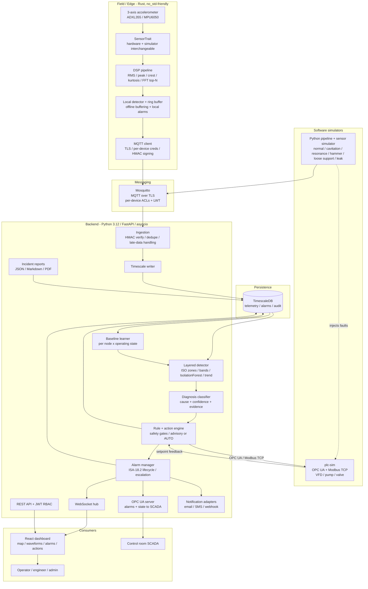
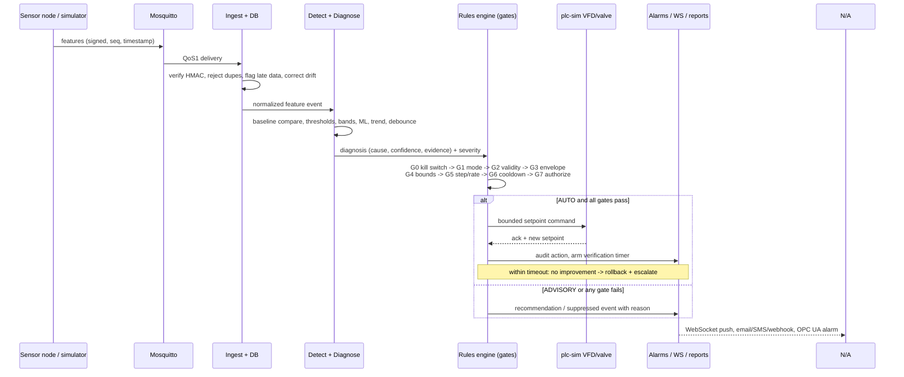
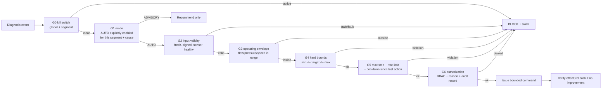
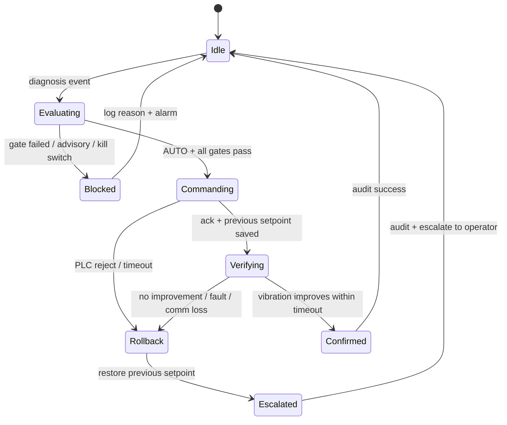

# PipeGuard — System Architecture (Phase 0 Plan)

**Status:** Phase 0 baseline. This document is the authoritative design contract for
the prototype. It is updated as phases are implemented so that code, tests and docs
stay consistent.

## 1. Purpose and scope

PipeGuard is a vibration monitoring, diagnosis and response system for petroleum
pipeline pump stations and line segments. It:

1. samples a 3-axis accelerometer at 1–4 kHz on an edge node,
2. extracts on-device features (RMS, peak, crest factor, kurtosis, FFT top-N peaks),
3. publishes signed, timestamped telemetry over MQTT/TLS,
4. learns per-node baselines conditioned on operating state (flow, pressure, pump
   speed),
5. detects abnormalities with layered, debounced rules + ML,
6. diagnoses the probable cause with evidence and confidence,
7. optionally issues **bounded, audited, reversible** commands to field devices
   (VFD/pump/valve) through OPC UA or Modbus TCP,
8. raises ISA-18.2-style alarms, notifies operators, and produces incident reports.

The prototype runs entirely in software: a Python pipeline/sensor simulator and a
simulated PLC/VFD/valve server replace hardware. The Rust edge firmware is written
against a `SensorTrait`, so the simulator and real accelerometer drivers are
interchangeable.

### 1.1 Safety posture (read this first)

This is a **safety-critical, advisory-by-default** system.

- PipeGuard **never writes to SIS / ESD / emergency shutdown systems**. Those are
  independent safety instrumented functions and are out of scope for actuation.
- Every automatic action is bounded by hard limits enforced in code (min/max, max
  step, rate limit, cooldown, operating envelope) and by an explicit per-segment
  `AUTO` opt-in. Default mode is `ADVISORY`.
- A global and per-segment **kill switch** disables automation immediately.
- Critical actions such as mainline valve isolation are **never automatic**: they
  are recommendations requiring human confirmation.
- Any action whose effect cannot be verified is rolled back and escalated.

## 2. Component diagram



The **simulator can feed the same topics as the Rust node**, so phases 2–6 are
testable before firmware exists. In Phase 7 the Rust node publishes the identical
schema; the backend cannot tell the difference.

## 3. Data flow



Numbered flow:

1. **Sample** — `SensorTrait::read()` returns a 3-axis frame at 1–4 kHz. The
   simulator generates an equivalent stream with realistic noise and fault
   signatures.
2. **Feature extraction** — overlapping windows (default 0.5 s, 50 % overlap)
   produce RMS, peak, crest factor, kurtosis, band energies, and FFT top-N peaks.
3. **Edge buffering** — a ring buffer keeps raw samples for triggered upload and
   survives broker loss; local detection continues offline.
4. **Publish** — features are published to MQTT/TLS with a monotonic sequence
   number, UTC timestamp, operating state, health block and HMAC-SHA256 signature.
5. **Ingest** — backend verifies signature against the device key, drops duplicate
   `(node_id, sequence)`, flags messages older than a configured lateness budget,
   estimates clock drift, and writes to TimescaleDB.
6. **Detect** — per-node/per-operating-state baseline + layered rules produce an
   anomaly score and severity; debounce, hysteresis and persistence timers
   suppress transients.
7. **Diagnose** — evidence rules (and optional IsolationForest score) classify the
   cause; multi-node time-of-arrival correlation localizes leaks/third-party digs.
8. **Decide** — the rule engine maps `cause + severity + operating state` to an
   action policy and passes through all safety gates.
9. **Act (only in AUTO)** — a bounded command is sent to the simulated VFD/valve
   via OPC UA or Modbus TCP; the previous setpoint is saved for rollback.
10. **Verify** — post-action vibration is compared against the pre-action baseline
    within a timeout; improvement confirms, otherwise rollback + escalation.
11. **Report** — alarms, notifications, audit records and incident reports are
    emitted; everything is queryable through REST, WebSocket and OPC UA.

### 3.1 Latency budget (detection → action command)

| Stage | Target | Notes |
|---|---:|---|
| Sampling window | 250–500 ms | configurable window |
| On-device DSP | ≤ 20 ms | Rust release build |
| MQTT publish + broker | ≤ 30 ms | local broker, QoS1 |
| Ingest + HMAC + DB write | ≤ 50 ms | async writer |
| Detect + diagnose | ≤ 200 ms | cached baseline |
| Rules + safety gates | ≤ 20 ms | in-process |
| PLC command dispatch | ≤ 300 ms | asyncua / pymodbus |
| **Total to command issued** | **< 2 s** | hard target |
| Effect verification | 5–30 s (async) | does not block command latency |

Measured values will be recorded in `docs/runbook.md` after the Phase 8 demo.

## 4. MQTT topic schema

All topics are rooted at `pipeguard/{site}/{segment}/{node}`. Identifiers are
lower-case, `[a-z0-9-]+`. QoS 1 for reliable delivery except raw waveform bursts
(QoS 0 or 1, configurable). TLS required; per-device username/password or client
certificate and ACL restricted to the node's own topics. Last-Will-and-Testament
publishes `online: false` to the status topic.

| Topic | Direction | Retained | Payload | Purpose |
|---|---|:---:|---|---|
| `pipeguard/{site}/{segment}/{node}/features` | node → backend | no | `FeatureMessage` | Primary periodic telemetry |
| `pipeguard/{site}/{segment}/{node}/raw` | node → backend | no | `RawMessage` | On-demand / trigger waveform |
| `pipeguard/{site}/{segment}/{node}/status` | node → backend | yes | `StatusMessage` | Health + LWT (`online` flag) |
| `pipeguard/{site}/{segment}/{node}/cmd/raw-request` | backend → node | no | `RawRequest` | Request waveform capture |
| `pipeguard/{site}/{segment}/{node}/cmd/config` | backend → node | no | `ConfigMessage` | Push thresholds/window (signed) |
| `pipeguard/{site}/{segment}/alarm` | backend → consumers | no | `AlarmMessage` | Alarm lifecycle events |
| `pipeguard/{site}/{segment}/action` | backend → consumers | no | `ActionAuditMessage` | Every actuation attempt |
| `pipeguard/{site}/{segment}/incident` | backend → consumers | no | `IncidentMessage` | Report-ready incident summary |

### 4.1 `FeatureMessage` (JSON canonical form; CBOR optional)

```json
{
  "schema_version": "1.0",
  "message_id": "7f1e2c44-6b70-4b2e-9c1a-0d3f5a7b9e11",
  "node_id": "node-03",
  "site": "gulf-north",
  "segment": "seg-12",
  "timestamp": "2026-11-20T12:34:56.789Z",
  "sequence": 41822,
  "operating_state": {
    "flow_m3h": 820.5,
    "pressure_kpa": 3450.0,
    "pump_speed_rpm": 2950.0,
    "valve_position_pct": 100.0
  },
  "features": {
    "sample_rate_hz": 2000,
    "window_seconds": 0.5,
    "accel_rms_mps2": {"x": 0.12, "y": 0.09, "z": 0.44},
    "velocity_rms_mm_s": 2.8,
    "peak_mps2": 1.71,
    "crest_factor": 3.1,
    "kurtosis": 2.4,
    "band_energies": {"10_50": 0.02, "50_150": 0.11, "150_500": 0.31, "500_2000": 0.56},
    "fft_peaks": [
      {"hz": 24.5, "amplitude_mps2": 0.31},
      {"hz": 49.1, "amplitude_mps2": 0.18}
    ]
  },
  "health": {
    "battery_pct": 87.2,
    "temp_c": 41.5,
    "mem_free_kb": 184,
    "sampling_ok": true,
    "drift_ppm": 3.1,
    "clock_skew_ms": -4
  },
  "signature": "hmac-sha256=b7c1...e93f"
}
```

Signature input is the canonical JSON of all fields except `signature`: keys
sorted recursively, no insignificant whitespace, UTF-8, HMAC-SHA256 with the
per-device key. Backend rejects bad signatures, unknown devices, non-monotonic
sequence numbers and future timestamps beyond a configured skew.

### 4.2 `RawMessage`

```json
{
  "schema_version": "1.0",
  "node_id": "node-03",
  "sequence": 41823,
  "t0": "2026-11-20T12:34:56.789Z",
  "sample_rate_hz": 4000,
  "axis": "z",
  "samples_mg": [12, -4, 7, 31, "..."],
  "trigger_reason": "anomaly_confirmation",
  "signature": "hmac-sha256=..."
}
```

### 4.3 Handling imperfect data

- **Missing:** watchdog on expected publish interval; status LWT marks node
  offline; baselines are not updated; fail-safe blocks automation for that node.
- **Late:** accepted if within `max_late_seconds` (default 10 s) but tagged
  `late=true` and excluded from real-time detection; can be backfilled.
- **Duplicate:** `(node_id, sequence)` is a unique key; duplicates are counted
  and discarded.
- **Drift:** sensor bias is estimated from long-term zero-g/thermal trend and
  compensated; excessive drift raises a sensor-fault alarm and blocks actuation.

## 5. Persistence model (TimescaleDB)

| Table | Type | Contents | Retention |
|---|---|---|---|
| `feature_samples` | hypertable | every feature message + operating state | 90 d raw, continuous aggregates 2 y |
| `raw_waveforms` | hypertable | triggered/raw captures | 30 d |
| `baselines` | regular | per node × operating-state statistics/model blob | versioned |
| `detections` | hypertable | scores, layered rule hits, debounce state | 1 y |
| `diagnoses` | hypertable | cause, confidence, evidence JSON | 1 y |
| `alarms` | regular/hypertable | state, priority, ack, shelf, escalation | 2 y |
| `actions_audit` | hypertable | who/what/why/before/after/result/gate reasons | 2 y (immutable) |
| `incidents` | regular | timeline + report artifacts | forever |
| `node_config` | regular | thresholds/policy per segment, version | config history |

Config files in `backend/config/*.yaml` are the source of truth for operational
thresholds and are loaded at startup; DB rows record the effective version used
for each decision. Evidence-ranking heuristics live in the classifier and are
covered by the offline evaluation report.

## 6. Detection and diagnosis design

### 6.1 Layered detection

1. **Baseline** — per node × operating-state bucket: robust mean/σ of RMS,
   kurtosis, band energies; z-score and EWMA deviation.
2. **Thresholds** — configurable ISO 10816/20816-style velocity RMS zones
   (A/B/C/D) with per-segment overrides.
3. **Spectral bands** — energy ratios across configurable bands (e.g. 10–50,
   50–150, 150–500, 500–2000 Hz).
4. **ML anomaly** — IsolationForest on the feature vector; optional autoencoder
   later; score normalized 0–1.
5. **Trend** — rate-of-change / sustained ramp detection over a short window.

Combination: weighted score → severity (advisory/warning/critical) with
**debounce (N of M), hysteresis (separate clear threshold), and persistence
timers** to avoid flapping. Operating state gates which thresholds apply.

### 6.2 Diagnosis rules

| Cause | Primary evidence | Typical action policy |
|---|---|---|
| Pump cavitation | high 500–2000 Hz band energy + pressure drop | reduce VFD speed in small steps, raise suction setpoint |
| Resonance / flow-induced | narrow peak near known natural frequency | shift VFD off resonant band (skip-frequency) |
| Water hammer / surge | transient spike, high crest factor, pressure surge | slow valve closing rate, enable surge relief |
| Loose / failed support | low-frequency, impact-like, high kurtosis | advisory inspection work order |
| Leak / third-party dig | localized broadband + multi-node TDOA | **critical alarm, human-confirmed isolation only** |
| Imbalance / misalignment | 1×/2× running-speed harmonics | advisory maintenance |

Output is a structured `Diagnosis`: `cause`, `confidence` (0–1),
`evidence[]` (feature name, observed value, expected value, weight),
`recommended_action`, and optional `location_estimate`.

## 7. Safety design

### 7.1 Safety gates (all must pass for AUTO)



Additional hard rules:

- **Never** address SIS/ESD tags. A deny-list of tag namespaces is enforced in
  the actuation adapter and tested; any such target raises a critical alarm.
- Mainline valve isolation and emergency shutdown are **recommendations only**.
- Targets are clamped to configured `min`/`max`; a command exceeding `max_step`
  from current value is rejected, not silently clamped.
- Rate limit: at most N changes per minute; cooldown: minimum seconds between
  commands to the same device.
- **Fail-safe:** communication loss, unsigned/stale telemetry, sensor fault, or
  missing verification data ⇒ no action + alarm.
- Every attempt (allowed, blocked, or rolled back) writes an immutable audit row.

### 7.2 Actuation state machine



### 7.3 Example policy (config-as-code)

```yaml
policies:
  cavitation:
    default_mode: advisory
    auto_segments: []            # opt-in, e.g. [seg-12] only after approval
    action:
      target: vfd_speed_rpm
      protocol: opcua
      direction: decrease
      max_step_rpm: 75
      min: 1200
      max: 3600
      rate_limit_per_min: 2
      cooldown_s: 45
      operating_envelope:
        pressure_kpa: [1800, 4200]
        flow_m3h: [300, 1100]
    verification:
      timeout_s: 20
      min_improvement_pct: 10
      rollback_on_timeout: true
    notifications: [dashboard, email]
  leak:
    default_mode: advisory
    auto_segments: []
    action:
      type: recommend_isolation   # never auto-close mainline valves
      priority: critical
```

## 8. Alarm management

ISA-18.2-style lifecycle: `ACTIVE → ACKED → CLEARED → CLOSED`, with `SHELVED`
(temporary, timed) and `SUPPRESSED` states. Priorities: **advisory**, **warning**,
**critical**. Escalation timers re-notify if an alarm is unacknowledged after a
configured period. Notifications are pluggable adapters (dashboard WebSocket,
email, SMS/webhook). REST and an OPC UA alarm server expose state to SCADA.

## 9. Repository layout

```
/firmware        Rust edge node + SensorTrait + host simulator build
/simulator       Python pipeline/sensor simulator (fault injection)
/backend         FastAPI, ingestion, analytics, rules, actuation, alarms
/dashboard       React control-room UI
/plc-sim         OPC UA + Modbus simulated pump/VFD/valve
/infra           docker-compose, mosquitto config, DB migrations
/docs            architecture (this file), safety case, runbook, API spec
```

## 10. Delivery phases

| Phase | Deliverable | Verification |
|---|---|---|
| 0 | This architecture plan | document review |
| 1 | Fault simulator + signal generation | pytest unit tests |
| 2 | Ingestion + TimescaleDB + detection | pytest + compose integration |
| 3 | Diagnosis classifier + evaluation | confusion matrix report |
| 4 | Rules engine + plc-sim + safety guards | heavy safety unit tests |
| 5 | Alarms + notifications + reports | lifecycle tests |
| 6 | React dashboard | build + lint |
| 7 | Rust firmware + MQTT integration | cargo test + compose |
| 8 | `make demo` end-to-end scenario | full scenario run |
| 9 | README + runbook + roadmap | doc consistency |

## 11. Assumptions and compliance context

Detailed in `docs/safety-and-compliance.md` (Phase 9). Summary:

- Hazardous-area hardware must be ATEX/IECEx intrinsically safe with appropriate
  barriers/enclosures; this prototype assumes certified devices in Zone 2/div 2.
- Cybersecurity follows IEC 62443 zoning: field zone, control zone, DMZ; TLS,
  per-device identities, signed firmware/config, JWT RBAC.
- Integrity/maintenance context: API 570, ASME B31.4; vibration thresholds are
  engineering-configurable and must be validated per asset.
- This prototype is **not** a certified SIS and must not be used as one.
